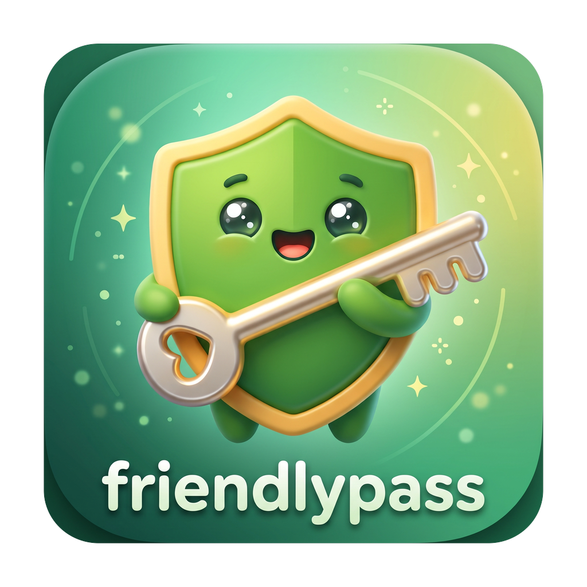
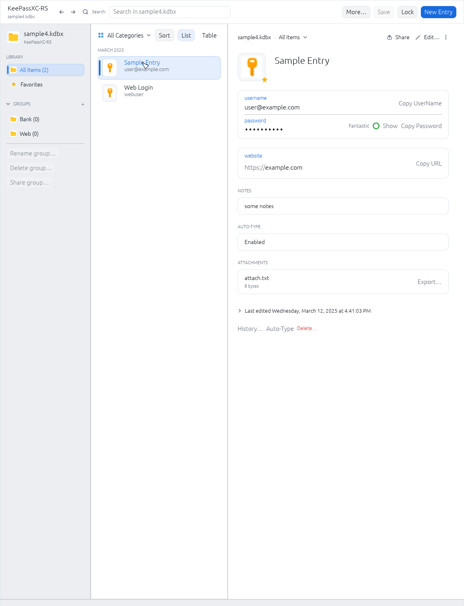
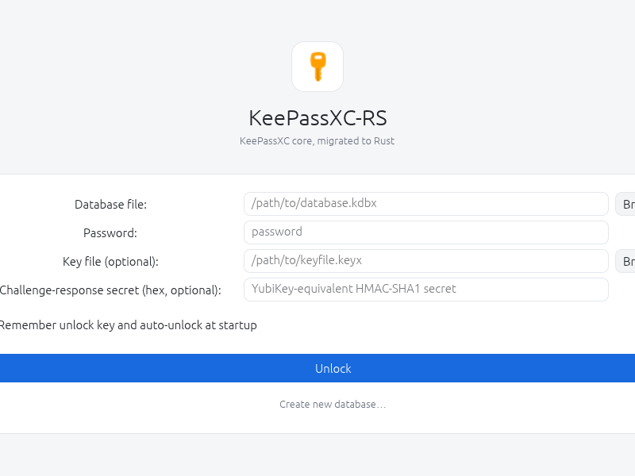

# friendlypass

<p align="center">
  
</p>

**A friendly password manager for KeePass databases** — a Rust
reimplementation of KeePassXC's headless core *plus* a cross-platform desktop
GUI, a browser extension with its native-messaging host, and an Android app,
composing the Rust ecosystem instead of rewriting existing functionality.

The name is the `friendlypass` binary (CLI), the `friendlypass-gui` desktop
app, the `extension/` browser add-on and the Android app. Databases stay
standard KDBX files, so they keep opening in KeePassXC, KeePass, and mobile
KeePass apps.

The original C++ implementation is KeePassXC
(https://github.com/keepassxreboot/keepassxc); friendlypass is built to be
behaviorally compatible with it.

## What it does

`friendlypass` (the binary) is a drop-in-style replacement for the core
`keepassxc-cli` commands:

| command             | keepassxc-cli equivalent | notes                                     |
|---------------------|--------------------------|-------------------------------------------|
| `db-create`         | `db-create`              | KDBX 4.1; Argon2id/Argon2d/AES-KDF; AES256/ChaCha20/Twofish; GZip/none; optional generated `.keyx` keyfile |
| `db-info`           | `db-info`                | version, cipher, KDF, compression, counts |
| `ls`                | `ls -f`                  | recursive listing with full paths         |
| `show`              | `show`                   | decodes protected fields (`-a`: extra attributes) |
| `search`            | `search`                 | title/username/URL/notes matching        |
| `add`               | `add`                    | prompts / generates entry passwords      |
| `mkdir`             | `mkdir`                  | nested paths (`Web/Sub`)                 |
| `attachment-export` | `attachment-export`     | byte-identical export                    |
| `attachment-add`    | —                        | attach a file to an entry (replaces a same-named one) |
| `attachment-remove` | —                        | detach a file (the previous revision stays in entry history) |
| `export`            | `export`                 | KeePass 2 XML (`-f xml`), CSV, HTML to stdout |
| `import`            | `import`                 | XML, CSV, Bitwarden/Proton Pass JSON, 1PUX, KeePass 1 KDB (AES/Twofish), KDBX into a new database |

Passwords are read from a hidden prompt on a TTY, or one line from stdin when
piped (same convention as keepassxc-cli: `printf 'pw\n' | friendlypass ls db.kdbx`).

Modifying a KDBX 3.x database transparently upgrades it to KDBX 4.1 on save
(the `keepass` writer supports KDBX 4), which is also KeePassXC's
modernization direction. Saves are atomic (temp file + rename).

## Architecture: built on existing crates

Per the project requirement, existing Rust packages provide the engine
layers; this project is the behavior/compatibility layer on top:

* [`keepass`](https://crates.io/crates/keepass) 0.17 — KDBX 3.1/4.0/4.1
  container parsing **and** writing, Argon2d/Argon2id and AES-KDF, AES-256 /
  Twofish / ChaCha20 outer ciphers, Salsa20/ChaCha20 inner streams, GZip,
  XML v1/v2 keyfiles, the XML document model.
* `clap` — CLI; `rpassword` — prompts; `rust-argon2` — KDF parameter types;
  `sha2`/`getrandom` — keyfile generation; `anyhow` — errors.
* `friendlypass` itself contributes the keepassxc-cli-compatible commands, the
  KeePassXC-compatible XML-v2 keyfile *generator* (with the correct Hash
  attribute and 32-byte key data so KeePassXC and keepass-rs agree),
  password generation, the KDBX3→4.1 upgrade-on-save, atomic writes, and
  friendly credential errors.
* The rest of the workspace composes the other surfaces:
  `friendlypass-browser` (KeePassXC-Browser protocol server) and
  `friendlypass-browser-host` (native-messaging host), `friendlypass-passkey`
  (WebAuthn authenticator over KeePassXC's `KPEX_PASSKEY_*` attributes),
  `friendlypass-ssh-agent`, and `friendlypass-mobile` (UniFFI cdylib for
  Android). `extension/` is a hard fork of keepassxc-browser and `android/` is
  the Kotlin app on top of the cdylib.
* `vendor/challenge-response` — a local compatibility patch for the
  `challenge_response` 0.5.46 crate (pulled in by keepass's
  `challenge_response` feature): its `nusb` backend calls the Linux-only
  `DeviceInfo::busnum()` and does not compile on macOS. The patch adds a
  small platform shim; only the software `LocalChallenge` component is used
  (no USB transport), so behavior is unchanged.

## Preferences

Display preferences persist as JSON in the platform configuration directory
(`~/Library/Application Support/friendlypass-gui/config.json` on macOS,
`%APPDATA%\friendlypass-gui\config.json` on Windows,
`$XDG_CONFIG_HOME/friendlypass-gui/config.json` on Linux; override with the
`FRIENDLYPASS_GUI_CONFIG` environment variable). It stores the column layout and the
recent-database list — no passwords or key material. Column widths are also
persisted through eframe's egui-memory storage. A missing or corrupt config
file falls back to defaults, so the app always starts.

## Keyboard shortcuts

| Keys | Action |
| --- | --- |
| `Cmd/Ctrl+C` | Copy password of the selected entry |
| `Cmd/Ctrl+B` | Copy username |
| `Cmd/Ctrl+U` | Copy URL |
| `Cmd/Ctrl+T` | Copy TOTP code |
| `Cmd/Ctrl+F` | Focus the search box |
| `Cmd/Ctrl+N` | New entry |
| `Cmd/Ctrl+Shift+N` | New group |
| `Cmd/Ctrl+E` / `Enter` | Edit the selected entry |
| `Cmd/Ctrl+H` | Entry history |
| `Cmd/Ctrl+G` | Password generator |
| `Delete` / `Backspace` | Recycle the selected entry (with confirmation) |
| `Cmd/Ctrl+S` | Save |
| `Cmd/Ctrl+Shift+S` | Save as… |
| `Cmd/Ctrl+L` | Lock the database |
| `F1` | Shortcut reference |
| `Escape` | Close a dialog / clear the search |
| `Enter` | Confirm a dialog (`Cmd+Enter` applies the entry editor) |

The same map is available in the app via **Shortcuts…** in the toolbar or `F1`.
Shortcuts that edit entries are inactive while a text field has focus, so
normal typing (and `Cmd+C` inside the search box) keeps working.

## Compatibility, verified

`./verify.sh` runs the full cross-check against the **real KeePassXC
2.8.0** (`keepassxc-cli`):

1. every fixture created by keepassxc-cli opens in `friendlypass` — KDBX 3.1
   (AES256, AES-KDF up to 14.3M rounds, Salsa20 inner stream, attachments,
   keyfiles, empty password, non-ASCII password) and KDBX 4.0 (ChaCha20);
2. databases created *and modified* by `friendlypass` open in keepassxc-cli, across
   all cipher/KDF/compression variants;
3. a KDBX 3.1 database upgraded to 4.1 by `friendlypass` opens in keepassxc-cli with
   all entries and attachments intact;
4. attachments and generated keyfiles round-trip byte-identically;
5. `cargo test --release --workspace` — the whole workspace suite (374 tests
   today: core/CLI, GUI kittest, SSH agent, browser + host, passkeys, mobile).
   The extension's unit tests and typecheck also run when `extension/node_modules`
   has been installed.

`./verify.sh` has 82 gates (81 without `KEEPASSXC_SRC`, which skips the
byte-identical attachment comparison; the two extension gates need
`extension/node_modules`) and exits non-zero if any fails.

Current result: **81 pass, 0 fail, 1 skipped** — the skipped gate is the
byte-identical attachment comparison, which needs `KEEPASSXC_SRC`.

## Layout

```
crates/friendlypass/              CLI + library: KDBX engine, commands, import/export, KeeShare
crates/friendlypass/tests/        integration tests against `fixtures/`
crates/friendlypass-gui/          desktop app (egui/eframe) + headless kittest UI tests
crates/friendlypass-ssh-agent/    SSH agent (unencrypted ssh-ed25519 subset) + binary
crates/friendlypass-browser/      browser-protocol server: crypto, actions, passkeys, peer verification
crates/friendlypass-browser-host/ native-messaging host `org.friendlypass.browser` + installer flags
crates/friendlypass-passkey/      WebAuthn authenticator + KeePassXC `KPEX_PASSKEY_*` storage
crates/friendlypass-mobile/       UniFFI cdylib `friendlypass_mobile` for Android
extension/                        MV3 extension (hard fork of keepassxc-browser) + vitest/Playwright tests
android/                          Android app (Compose, SAF, autofill, Credential Manager) + Gradle tests
protocol/                         frozen wire contract (`ACTIONS.md`) + golden fixtures
installer/                        registers the native host with Chrome-family browsers and Firefox
packaging/                        macOS .app bundle, Linux tarball/desktop entry
branding/                         logo and derived app icons
fixtures/                         real .kdbx/.kdb files (passwords below)
docs/                             screenshots referenced here
scripts/                          browser e2e entry point
vendor/challenge-response/        local platform shim for challenge_response 0.5.46
verify.sh                         end-to-end Rust <=> KeePassXC cross-verification
```

`verify.sh` cross-checks friendlypass against a KeePassXC 2.8.0 install
(`keepassxc-cli` on `PATH`, or `/Applications/KeePassXC.app` on macOS). One
check compares an attachment with KeePassXC's own test data and needs a
KeePassXC source checkout, given as `KEEPASSXC_SRC=/path/to/keepassxc`. When
that variable is unset, the check is skipped with a message.

Working on the code? See [`AGENTS.md`](AGENTS.md) for the crate map, test
commands and known gotchas.

## Fixture passwords

| file                 | password        | created by                    |
|----------------------|-----------------|-------------------------------|
| `sample4*.kdbx`      | `testpassword`  | keepassxc-cli 2.8.0           |
| `sample4.keyx`       | — (keyfile)     | keepassxc-cli 2.8.0           |
| `Format400.kdbx`     | `t`             | KeePassXC repo test data     |
| `Compressed.kdbx`    | *(empty)*       | KeePassXC repo test data     |
| `NonAscii.kdbx`      | `Δöض`           | KeePassXC repo test data     |
| `ProtectedStrings.kdbx` | `masterpw`   | KeePassXC repo test data     |
| `keepass1.kdb` / `keepass1-twofish.kdb` | `masterpw` | KeePassXC repo test data (KDB, AES / Twofish) |

## Usage

```console
$ cargo build --release
$ printf 'mypw\n' | target/release/friendlypass ls fixtures/sample4.kdbx
Bank/
Web/
Sample Entry
Web Login
$ printf 'mypw\n' | target/release/friendlypass show fixtures/sample4.kdbx "Sample Entry"
Title:    Sample Entry
UserName: user@example.com
...
$ printf 'mypw\n' | target/release/friendlypass export -f csv fixtures/sample4.kdbx
"Group","Title","Username","Password",...
$ printf 'masterpw\nnewpw\nnewpw\n' | \
    target/release/friendlypass import fixtures/keepass1.kdb imported.kdbx --set-password
Successfully imported KeePass 1 (KDB) into imported.kdbx
```

## Import / export

`friendlypass export -f xml|csv|html` matches `keepassxc-cli export` (the CSV is
byte-identical for the fixture, and `keepassxc-cli import` accepts our XML).
`friendlypass import` creates a new database from:

| Format | Notes |
| --- | --- |
| KeePass 2 XML (`.xml`) | both our exports and `keepassxc-cli export -f xml`; groups, fields, tags, attachments, auto-type, custom icons and times |
| CSV (`.csv`) | KeePassXC's header, plus common Title/Username/Password/URL/Notes/Folder layouts; unknown columns become custom attributes; group paths are recreated |
| Bitwarden JSON (`.json`) | unencrypted exports: folders → groups, logins, URIs, TOTP, notes, custom fields (hidden fields stay protected) |
| Proton Pass JSON (`.json`) | unencrypted exports: vaults → groups, logins/credit cards/Wi-Fi/SSH keys, extra fields; auto-detected when a `.json` has `vaults` |
| 1Password 1PUX (`.1pux`) | vaults → groups, login fields, notes, URLs, section fields |
| KeePass 1 KDB (`.kdb`) | AES-256 and Twofish; groups/levels, entries, attachments, auto-type lines, packed timestamps; the KDB meta streams are hidden like KeePassXC does |
| KeePass 2 KDBX (`.kdbx`) | opened with its password (and optional key file through the API) |

Not yet supported: encrypted third-party exports (Bitwarden/Proton Pass
encrypted JSON is rejected) and 1Password's legacy `.opvault` format.
Everything else round-trips through the `keepass` crate and is covered by
tests and real-tool cross-checks (see below).

### Launching without a terminal window

A bare Unix executable is opened *through Terminal* when double-clicked in
Finder. The GUI therefore ships a macOS app-bundle script:

```console
$ ./packaging/macos/install.sh          # builds + installs to /Applications
$ open -b org.friendlypass.friendlypass # or open it from Finder/Launchpad
```

`packaging/macos/package.sh` only builds the bundle under `target/release/`
if you do not want to install it.

The app is launched by LaunchServices (parent process `launchd`, not
Terminal), has an `Info.plist` with bundle id `org.friendlypass.friendlypass`,
an icon and an ad-hoc signature. Re-run the script after rebuilding.

On **Windows**, release builds use the GUI subsystem
(`windows_subsystem = "windows"`), so double-clicking `friendlypass-gui.exe` does not
open a console; debug builds keep it for logs. On **Linux**, install
`packaging/linux/friendlypass.desktop` (`Terminal=false`) and the matching
hicolor icon so the desktop launcher starts the GUI directly, with its icon.

## Startup and automatic unlock

**Run at login.** Open **Settings…** in the main window and tick *Launch at
login* (also available as `friendlypass-gui --enable-launch-at-login` /
`--disable-launch-at-login` from the app bundle's executable). This writes:

* macOS: a `~/Library/LaunchAgents/org.friendlypass.friendlypass.plist` LaunchAgent that
  opens the `.app` through LaunchServices (`launchctl bootstrap`, no Terminal)
* Windows: `HKCU\Software\Microsoft\Windows\CurrentVersion\Run`
* Linux: `~/.config/autostart/org.friendlypass.friendlypass.desktop`

**Automatic unlock.** On the unlock screen tick *Remember unlock key and
auto-unlock at startup* and unlock once. The app stores the password, key-file
bytes and challenge-response secret in the operating system credential store
— macOS **Keychain**, Windows **Credential Manager**, Linux **Secret
Service** (via the `keyring` crate). Nothing is written unencrypted by the
app. On the next launch `App::new` finds the secret for the last database,
rebuilds the KeePass key and opens it before the first frame; if anything
fails (wrong secret, missing keychain access), it falls back to the normal
unlock screen with an explanatory error.

*Settings → Forget saved unlock key* deletes the keychain item and turns
auto-unlock off.

**Windows accounts without a login password:** Credential Manager may be
unavailable there. Enable *Use a DPAPI-protected file instead of Credential
Manager* in Settings; the secret is then encrypted with Windows DPAPI in
`%APPDATA%\friendlypass-gui\auto-unlock.dpapi`. This is intentionally an explicit,
weaker option: any program running as that Windows user can ask DPAPI to
decrypt it. The Windows DPAPI path is type-checked against the real
`windows-sys` 0.61 bindings; its runtime behavior needs Windows to verify.

Security note: auto-unlock is only as strong as your logged-in OS session.
Anyone who can use your unlocked account can start the app and open the
database; leave the option off on shared machines.

## GUI (`friendlypass-gui`)






`cargo run --release -p friendlypass-gui -- [database.kdbx]` launches the
cross-platform GUI (egui/eframe — pure Rust, runs on macOS, Windows and
Linux). It mirrors KeePassXC's core GUI workflow:

* **Unlock screen** — database file, password (Enter to unlock), optional
  key file, friendly error reporting for bad credentials
* **Group tree** — navigate, add / rename / delete groups, with icons rendered
* **Recycle bin** — deleting entries/groups moves them to the Recycle Bin
  (created lazily and registered in the database metadata, exactly like
  KeePassXC); deleting from inside the bin is permanent; "Empty Recycle
  Bin…" action
* **Entry table** — sortable columns (Title / UserName / Password / URL /
  Notes / Tags), password masking with a global reveal toggle,
  double-click to edit, search across all groups, website favicons, letter
  avatars and database custom icons rendered per entry
* **Multi-selection** — Cmd/Ctrl-click rows for batch operations: move to
  group, recycle
* **Drag & drop** — drag entries onto group rows (including the root and
  the Recycle Bin) to move them; drag groups onto other groups (into the
  root, or into the Recycle Bin), with KeePassXC's cycle prevention
* **Auto-type execution** — the entry's sequence is resolved (all KeePass
  placeholders, `{TAB}`/`{ENTER}`, `{DELAY x}`) and injected as real
  keystrokes via `enigo` after a 1.5 s countdown; the pipeline is fully
  unit-tested through a recording injector (on macOS, actual injection
  requires the user to grant the app the Accessibility permission)
* **Entry references** — insert `{REF:…}` references to other entries'
  fields through the editor; the details panel resolves them (and the
  original KeePassXC resolves references written by this GUI)
* **Responsive layout** — the window adapts instead of clipping: the
  toolbar moves the search box to its own row when narrow, the library
  sidebar hides itself below ~1000 pt (and comes back from the toolbar
  toggle or the list's group picker), and below ~820 pt the entry list and
  the details pane stack vertically. Attachment rows keep their buttons off
  the file name by shortening names in the middle and, in very narrow
  panes, moving Export/Delete onto their own line
* **Attachment visibility** — entries with files show a paperclip marker
  (with a count when there are several) in both list and table views, and
  the sidebar's **Attachments** row filters the list to those entries
* **Back / Forward** — the toolbar arrows walk through the entries you have
  visited, revealing each entry's group and clearing filters as needed
* **Collapsible sections** — the GROUPS and TAGS sidebar headings really
  collapse (their chevrons are interactive), which keeps short windows usable
* **Icons** — database custom icons, favicons fetched from each entry's URL,
  deterministic letter avatars (optional single-glyph symbol via
  `friendlypass.symbol`), and a generic folder/trash glyph for groups; the
  KDBX standard `IconID` values are preserved untouched
* **Import… / Export…** — the same formats as the CLI, through dialogs:
  imports are merged into the open database (root group), exports warn that
  the XML/CSV/HTML file is unencrypted
* **Per-group export** — right-click a group in the tree and choose
  *Export as KeePass 2 XML… / CSV… / HTML…*; only that group and its
  descendants are written (the group becomes the XML root / CSV path root)
* **Inline editing** — **Edit…** opens the full editor in the right column
  (replacing the details view), with the same fields, attributes, auto-type,
  references and icon picker as the New Entry modal; OK/Cancel stay pinned
  at the top while the form scrolls
* **Passkeys** — entries with `KPEX_PASSKEY*` / `FRIENDLYPASS_PASSKEY*` attributes
  show a single **Passkey** chip; the raw credential/private-key fields are
  hidden from the generic attribute list
* **Entry details** — a group picker and an overflow (⋮) menu with all the
  secondary actions, plus copy username / password / URL to the clipboard,
  **live TOTP codes** for OTP entries (RFC 6238, refreshed every second,
  copy button), custom attributes, auto-type summary, and an **Attachments**
  card that manages files: **Add file…** (replaces a same-named attachment),
  per-file **Export…**, and **Delete** with a confirmation. Every change
  records an entry history revision and is saved with the database, so it is
  undoable from *History…*, and files also ride along through Save As and
  the CLI (`attachment-add` / `attachment-remove`)
* **Entry editor** — full field editing with a built-in password
  generator and reveal toggle; edits record entry history like KeePassXC;
  custom attribute editor with per-attribute protection toggles;
  auto-type editor (enable/disable, default sequence, clipboard
  obfuscation, window associations)
* **Entry history browser** — list revisions with dates and restore any
  revision (the restore itself is recorded in history, like KeePassXC)
* **Password generator dialog** — length, character classes, preview,
  copy to clipboard
* **Save / Save As** — with the KDBX 3.1 → 4.1 upgrade dialog
  (Cmd/Ctrl+S shortcut), atomic writes
* **Create new database** — Argon2id parameters, optional generated
  keyfile
* **Database info** dialog, **lock** button

The GUI is tested **headlessly with `egui_kittest`**
(`cargo test -p friendlypass-gui`): the tests drive the real `eframe` app by
clicking widgets and typing text, assert on the rendered UI and app
state, and produce image snapshots of the actual UI in
`crates/friendlypass-gui/tests/snapshots/`. The external-verification test
creates a database entirely through the GUI dialogs — entry with a
protected custom attribute and auto-type configuration, plus a second
entry deleted into the Recycle Bin — and the original C++ `keepassxc-cli
2.8.0` then confirms every bit of it: it lists the live entries, shows
"Temp Entry" inside the Recycle Bin group, prints the protected
attribute in clear text, and reports "Recycle bin is enabled"
(`verify.sh`, section 7).

## Browser extension and native messaging

`extension/` is a Manifest V3 extension hard-forked from keepassxc-browser
1.10.4.1. One source tree builds a Chrome bundle (`npm run build`) and a
Firefox MV3 event-page build (`npm run build:firefox`); `npm run package`
produces both zips.

The extension talks to its own native host, `org.friendlypass.browser`
(`crates/friendlypass-browser-host`), which forwards frames over a Unix
socket — `<user temp>/org.friendlypass.BrowserServer` — or a Windows named
pipe to the GUI or the `friendlypass-browser` library. The app side speaks the
KeePassXC-Browser protocol (X25519 handshake, libsodium-compatible
`crypto_box_easy`, nonce increment) and checks the browser's code signature
and the app-link peer on every connection. `protocol/ACTIONS.md` is the frozen
wire contract; `protocol/fixtures/` holds the golden frames.

Carried over or added: auto-fill, HTTP auth, password generation, TOTP
retrieval, lock/unlock push, and WebAuthn passkey registration and sign-in
(passkeys are on by default; the browser's own password prompts are turned
off).

```console
$ cd extension && npm ci && npm run build    # dist/, dist-firefox/
$ ./installer/install.sh                     # register org.friendlypass.browser
```

Tests:

```console
$ npx vitest run                         # 214 unit tests
$ npm run typecheck
$ npm run e2e                            # Playwright (Chromium)
$ npm run e2e:firefox                    # Puppeteer / WebDriver BiDi
$ cargo test -p friendlypass-browser -p friendlypass-browser-host
```

`scripts/e2e.sh` wraps the Chromium run with a fresh profile per test.

## Android

`android/` is a native Android app (`org.friendlypass.android`, Compose) over
the `friendlypass-mobile` UniFFI cdylib: SAF database storage, browse/search,
entry details, an autofill service (including one-time codes), a Credential
Manager provider with passkeys, and biometric unlock. The Rust/Kotlin boundary
is frozen in [`android/CONTRACT.md`](android/CONTRACT.md).

```console
$ cd android && ./gradlew :app:assembleDebug
```

Requires a rustup toolchain with the Android targets, `cargo-ndk`, the SDK,
NDK 28.2.13676358 and JDK 21 (see [`AGENTS.md`](AGENTS.md), "Android"). Tests:
`:app:testDebugUnitTest` plus `:app:connectedDebugAndroidTest` against an
emulator. The release workflow builds and signs the APK for a `vX.Y.Z` tag.

## Status & scope

Migrated and verified: the headless core (database open/save, all cipher and
KDF variants, entries/groups/attachments/protected fields, CLI commands above),
the GUI workflow described above, the SSH agent, the browser stack (protocol
server, native-messaging host, MV3 extension), the WebAuthn passkey
authenticator, and the Android app. Cross-checks: KeePassXC 2.8.0 in both
directions, real `ssh-keygen`/`ssh-add`, the shipped `keepassxc-proxy`, and
OpenSSL — see [Compatibility, verified](#compatibility-verified) for the
current gate status.

### Feature matrix

| Feature                                   | Status |
|-------------------------------------------|--------|
| Unlock (password + keyfile)                | ✅ tested |
| Group tree: add / rename / delete         | ✅ tested |
| Recycle bin (create-on-demand, move-to-bin, permanent delete, empty bin) | ✅ tested + C++ cross-checked |
| Entry table: sort, search, masked passwords | ✅ tested |
| Icons: custom icon pool + automatic website SVG / favicon fetching with cache + letter avatars | ✅ tested (custom icons and KDBX `IconID`s persisted; entries with a URL fetch the site's SVG icon or fallback favicon in the background and cache it in memory and on disk so each origin is fetched at most once; entries without one show a letter/symbol avatar on a deterministic palette colour) |
| Multi-selection & batch operations (move to group, recycle) | ✅ tested (Cmd/Ctrl-click) |
| Drag & drop (entries and groups onto groups, incl. root and Recycle Bin, with cycle prevention) | ✅ tested (simulated pointer drags for both) |
| Import / export (XML, CSV, HTML; Bitwarden, Proton Pass, 1PUX, KeePass 1 KDB AES/Twofish, KDBX) | ✅ tested: XML round-trip, byte-identical CSV export, real `keepassxc-cli` imports our XML (entries + attachments) and our importer reads its XML; KeePassXC's own KDB test databases (AES and Twofish) import with entries/attachments; Bitwarden/Proton Pass/1PUX fixtures tested. **Per-group export** via the group tree's right-click menu (XML/CSV/HTML, subtree only). ❌ 1Password legacy `.opvault` and encrypted third-party JSON |
| Scrollable panels | ✅ the group tree, entry details and unlock screen scroll when their content overflows (kittest ScrollIntoView checks); the entry table already virtual-scrolls |
| 1Password-inspired light UI | ✅ three columns (library sidebar with Favorites, groups and tags, card list with month sections, details), light palette with blue accents, rounded cards, large entry details header, inline field cards, website/security/notes/attachments sections, last-edited footer, List/Table switch — kittest snapshots |
| Sidebar tag filter | ✅ tags collected from all entries; clicking anywhere on a tag row filters the list to entries with that tag (click again or the × clears it); selecting a group/favorite clears the tag filter — kittest |
| Entry details layout | ✅ details live in the rightmost column, not under the groups/list; the group/list dividers never cross it — kittest geometry check |
| Entry details + clipboard copy | ✅ tested (light card layout with username/password/TOTP, website, security fields, notes, attachments, last edited) |
| Responsive layout | ✅ toolbar wraps, the sidebar auto-hides below 1000 pt (explicit toggle wins) and the list/details stack below 820 pt; `tests/ui_polish.rs` asserts that names never overlap the attachment buttons at 1150/900/700 pt, that the search box never overlaps the toolbar actions, and that the panes stack |
| Entry markers & filters | ✅ paperclip badge (with count) in list and table rows, announced to assistive tech; the sidebar Attachments row filters to entries with files; back/forward navigation and collapsible GROUPS/TAGS sections are covered by `tests/ui_polish.rs` |
| Entry attachments | ✅ **manage** them from the details panel: add a file, replace one of the same name, export, delete (with confirmation); names are reduced to bare file names; sizes are shown per file and in total. Each change records entry history, survives save/re-open, and is covered by `tests/attachments.rs`; `keepassxc-cli` exports friendlypass-written attachments byte-identically |
| Inline entry editing (right column) | ✅ **Edit…** replaces the details view with the editor; OK/Cancel pinned at the top while the form scrolls; kittest verifies the editor is in the right column and changes persist |
| Passkeys | ✅ `KPEX_PASSKEY*` / `FRIENDLYPASS_PASSKEY*` entries show a **Passkey** chip; raw fields are hidden from the attribute list — kittest |
| TOTP one-time passwords (live code + countdown + copy in details; RFC 6238 vectors SHA-1/8-digit/6-digit) | ✅ tested |
| Entry editor (all fields, tags, password generator; wide form fields) | ✅ tested |
| Run at startup | ✅ **Settings → Launch at login**: macOS LaunchAgent (LaunchServices, no Terminal), Windows `Run` registry key, Linux autostart entry; `--enable/--disable-launch-at-login` CLI flags — tested (plist generation) and enabled on this Mac |
| Automatic unlock on startup | ✅ opt-in on the unlock screen: password + key-file bytes + challenge-response secret stored in the OS keychain (macOS Keychain / Windows Credential Manager / Linux Secret Service), rebuilt on startup; Windows no-login-password option uses a DPAPI-protected file; tested with an in-memory store (password+keyfile, failure fallback) and the enroll/Settings flow. The Windows DPAPI implementation is cross-type-checked against `windows-sys` 0.61 (runtime verification needs Windows) |
| Keyboard shortcuts (KeePassXC-style: Cmd/Ctrl+C/B/U/T copy password/username/URL/TOTP, Cmd+F search, Cmd+N new entry, Cmd+Shift+N new group, Cmd+E/Enter edit, Cmd+H history, Cmd+G generator, Cmd+S save, Cmd+Shift+S save as, Cmd+L lock, Delete recycle, F1 shortcut reference; dialogs: Enter confirm, Escape cancel, Cmd+Enter apply editor) | ✅ implemented + tested (kittest key events exercise the real bindings) |
| Customizable entry columns | ✅ **Columns…** dialog: show/hide each column (Title, UserName, Password, URL, Notes, Tags), reorder with Up/Down, set starting width, reset to defaults; layout is persisted in the GUI config and restored on the next launch (`egui_extras` table widths additionally persisted by eframe) — tested |
| Remember previously opened databases | ✅ recent list (last 10, deduplicated, most recent first) on the welcome screen with click-to-select and "Clear recent list"; the last successfully opened/created/saved-as database is prefilled on the next launch; persisted as JSON — tested across two simulated launches |
| Custom attributes with protection toggles | ✅ tested + C++ cross-checked |
| Auto-type editor (default sequence, obfuscation, window associations, placeholder preview) | ✅ tested + C++ cross-checked |
| Entry references ({REF:…}) — insertion, resolution, persistence | ✅ tested + C++ cross-checked (keepassxc-cli resolves GUI-written references) |
| Entry history browser with restore        | ✅ tested |
| Password generator dialog                 | ✅ tested |
| Save / Save As / KDBX 3→4.1 upgrade       | ✅ tested + C++ cross-checked |
| New database (Argon2id, generated keyfile) | ✅ tested + C++ cross-checked |
| Database info / lock                     | ✅ tested |
| Auto-type execution (keystroke injection via `enigo`) | ✅ implemented + pipeline unit-tested with a recording injector; end-to-end injection requires the user to grant the macOS Accessibility permission (manual step) |
| SSH agent (key serving) | ✅ implemented + tested against the REAL ssh tooling: our parser reads `ssh-keygen` output; `ssh-keygen -y/-lf` accepts our written keys; `ssh-add -l` lists keys served from database attachments via the `friendlypass-ssh-agent` binary, the library server, AND the GUI's SSH Agent window; signatures verify. Subset: unencrypted `ssh-ed25519` (RSA/ECDSA + passphrase-encrypted documented as unsupported) |
| Browser integration (friendlypass browser protocol) | ✅ implemented: X25519 `change-public-keys` handshake, nonce-increment responses, encrypted `associate` / `test-associate` / `get-logins` / `generate-password` / `lock-database` with KeePassXC 2.8.0-compatible message shapes and error codes. The GUI's Browser window starts/stops the server on `<user temp dir>/org.friendlypass.BrowserServer`, so friendlypass and KeePassXC run side by side. Protocol interoperability is still checked against the REAL shipped `keepassxc-proxy` binary (handshake → associate → test-associate → get-logins → error replies) when KeePassXC's own socket is free |
| Browser extension + native host | ✅ MV3 extension (hard fork of keepassxc-browser 1.10.4.1) with Chrome and Firefox builds, own host id `org.friendlypass.browser`, own socket/pipe, browser code-signature and app-link peer verification; 214 extension unit tests, typecheck and Playwright e2e |
| Passkeys (WebAuthn) | ✅ `friendlypass-passkey` provides an ES256/EdDSA/RSA authenticator over KeePassXC's `KPEX_PASSKEY_*` attributes; the GUI shows passkey entries and the extension plus Android app register and assert credentials — crate tests and extension tests |
| Android app | ✅ Compose app over the UniFFI vault: SAF storage, browse/search/details, autofill (including one-time codes), Credential Manager provider, passkeys, biometric unlock; Gradle unit + instrumented suites (see `AGENTS.md`) |
| KeeShare (signed share containers) | ✅ full: classic (unsigned) shares **and signed shares**. Signed containers use KeePassXC's exact layout — ZIP with `container.share.kdbx` + `container.share.signature`, RSA PKCS#1 v1.5 SHA-256 over the database bytes hex-prefixed `rsa|`, signature XML carrying the signer name and the `ssh-rsa` public key blob — signed with a local self-signed X.509 identity (CN signer) persisted under the config dir. Verified on import (tampered containers rejected, signer reported). Cross-checked with real tools: `openssl dgst -sha256 -verify` reports Verified OK, `unzip -l` shows the KeePassXC layout, and `keepassxc-cli` reads the database inside our signed container |
| YubiKey challenge-response keys | ✅ challenge-response composite-key support implemented + tested: the response component is HMAC-SHA1(KDF seed, secret) — the same construction a YubiKey uses — via the keepass `challenge_response` feature (`LocalChallenge`); CLI (`--challenge-response <hex>`) and GUI unlock field; round-trip tests cover password+CR, keyfile+CR, and rejection of missing/wrong secrets. ❌ live USB YubiKey HID transport is not implemented — it needs physical YubiKey hardware |

## Licence

friendlypass is free software under the **GNU General Public License, version
3 only** (GPL-3.0-only). The full text is in [`LICENSE`](LICENSE); the
packaged browser-extension zips and the macOS app bundle include it too.

friendlypass is a Rust port of [KeePassXC](https://github.com/keepassxreboot/keepassxc)
(GPL-2 or GPL-3) and the browser extension is a hard fork of
[keepassxc-browser](https://github.com/keepassxreboot/keepassxc-browser)
(GPL-3.0). Upstream copyright notices, the licences and provenance of the
copied KeePassXC test databases and icon set, and the additional licence texts
are recorded in [`NOTICE.md`](NOTICE.md) and [`LICENSES/`](LICENSES/).

friendlypass comes with **ABSOLUTELY NO WARRANTY**, to the extent permitted by
law. It is an independent project, not affiliated with or endorsed by the
KeePassXC Team.
